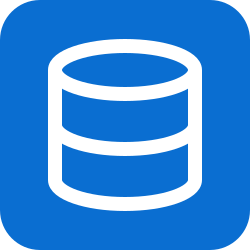

<p align="center">
  
</p>

# source-sap-hana

An open-source (MIT) [Airbyte](https://airbyte.com) source connector for **SAP HANA**, built on the
[Airbyte Python CDK](https://github.com/airbytehq/airbyte-python-cdk) and SAP's native `hdbcli` driver.

Airbyte's official SAP HANA connector is Enterprise-only. This one is a community alternative for Airbyte Open Source,
tested against a production S/4HANA system (tables such as `ACDOCA` with 1.6 billion rows) and running in Airbyte OSS 1.x (`abctl`, amd64 and arm64).

User documentation in Airbyte's format: [docs/sap-hana-oss.md](docs/sap-hana-oss.md).

## Features

| | |
|---|---|
| **Discovery** | Tables (and optionally views) from the `SYS` catalog, with primary keys. Filter by schema and SQL `LIKE` patterns, which you need for SAP ERP schemas with 100k+ tables. |
| **Resumable full refresh** | Tables with a primary key are read in pages ordered by the key, with a checkpoint after each page. An interrupted sync resumes after the last emitted row, with no duplicates. |
| **Incremental (cursor)** | Any orderable column (integer, decimal, date, timestamp, string). A checkpoint never splits rows that share a cursor value. |
| **Per-stream settings** | Per table, you can set a row filter in SQL (`RCLNT = '100' AND GJAHR >= '2025'`) that applies in every sync mode, a default cursor, and a primary key override for tables without a PK constraint (e.g. `ACDOCA`). |
| **SSH tunnel** | Airbyte's standard `tunnel_method` (key or password) through a bastion host. The tunnel reconnects by itself if the bastion drops the session. |
| **Resilience** | Reconnects automatically on transient HANA errors (`-10807 Connection down`, `-10709 Connection failed`, …) and resumes from the last checkpoint. The retry budget resets whenever the sync makes progress. |
| **Fast** | Streams rows with `fetchmany`, so memory stays flat. Protocol compression is on by default: 941k `MAKT` rows over VPN took 23 s with it and 86 s without. |
| **SAP quirks** | Quotes every identifier (`/BIC/...` namespaces), strips NUL characters (e.g. `MAKT`) that PostgreSQL rejects, reads LOBs. |
| **TLS / HANA Cloud / MDC** | `encrypt`, certificate validation, custom PEM trust store, tenant database, plus any extra `hdbcli` property. |
| **Parallel reads** | `max_concurrent_streams` reads several tables at once, each on its own connection (7 tables: 23.5 s → 9.2 s with 3 workers). Off by default. |
| **Progress & validation** | Row estimates from `SYS.M_TABLES` let the Airbyte UI show progress. `check` runs every row filter against HANA, so a typo fails at setup instead of mid-sync. |
| **Isolated failures** | A failing stream is reported as `INCOMPLETE` while the other streams keep syncing. The sync then fails with a clear error. |

## Quick start

Build the image for your Airbyte host's architecture (`linux/amd64` or `linux/arm64`) and push it to a registry
your Airbyte instance can pull from:

```bash
docker build --platform linux/amd64 -t <registry>/source-sap-hana:0.4.1 .
docker push <registry>/source-sap-hana:0.4.1
```

Without a registry, `scripts/deploy_to_airbyte.sh root@<airbyte-host>` builds for the right architecture and loads the
image straight into an `abctl` (kind) or docker-compose Airbyte over SSH.

In Airbyte OSS: *Settings → Sources → + New connector → Add a new Docker connector*
→ image `<registry>/source-sap-hana`, tag `0.4.1`. Then create a source of type **SAP HANA (Open Source)**.

Minimal configuration:

```json
{
  "host": "hana.example.com",
  "port": 30015,
  "username": "AIRBYTE_READER",
  "password": "********",
  "schemas": ["SAPHANADB"],
  "table_name_patterns": ["ACDOCA", "MARA", "MAKT", "KNA1"]
}
```

### Required privileges

```sql
CREATE USER AIRBYTE_READER PASSWORD "..." NO FORCE_FIRST_PASSWORD_CHANGE;
GRANT SELECT ON SCHEMA SAPHANADB TO AIRBYTE_READER;       -- or per table
```

`SYS.TABLES`, `SYS.TABLE_COLUMNS`, `SYS.CONSTRAINTS` and `SYS.SCHEMAS` are public views. They only show objects the user can access.

## Configuration

| Field | Default | Notes |
|---|---|---|
| `host`, `port` | –, `30015` | SQL port (`3<nn>15` single-tenant, `3<nn>41+` tenant DBs, `443` HANA Cloud) |
| `username`, `password` | – | |
| `schemas` | – | e.g. `["SAPHANADB"]` (case-sensitive) |
| `table_name_patterns` | all | SQL `LIKE` patterns, e.g. `["ACDOCA", "CSK%", "MAR_"]` |
| `stream_settings` | – | Per-table `condition`, `cursor_field` and `primary_key` (see below) |
| `tunnel_method` | `NO_TUNNEL` | `SSH_KEY_AUTH` / `SSH_PASSWORD_AUTH` with `tunnel_host`, `tunnel_port`, `tunnel_user`, `ssh_key` / `tunnel_user_password` |
| `include_views` | `false` | Also expose views (e.g. calculation views published as SQL views) |
| `database_name` | – | Tenant DB, when connecting via the SYSTEMDB port |
| `encrypt`, `ssl_validate_certificate`, `ssl_trust_store` | `false`, `true`, – | |
| `compress` | `true` | HANA protocol compression |
| `connection_properties` | – | `key=value;key=value`, passed to `hdbcli.dbapi.connect` |
| `fetch_size` | `10000` | Rows per round-trip |
| `resumable_full_refresh` | `true` | Keyset pagination for tables with a primary key |
| `full_refresh_page_size` | `100000` | Rows per page |
| `max_concurrent_streams` | `1` | Streams read in parallel |
| `checkpoint_interval` | `10000` | Minimum rows between incremental checkpoints |
| `max_retries`, `retry_wait_seconds` | `5`, `30` | Reconnect policy |
| `decimal_handling` | `number` | `string` keeps full precision for more than 15 significant digits |
| `strip_nul_characters` | `true` | |

### Stream settings

```json
"stream_settings": [
  {
    "stream": "ACDOCA",
    "condition": "RCLNT = '100' AND GJAHR >= '2025'",
    "cursor_field": "TIMESTAMP",
    "primary_key": ["RCLNT", "RLDNR", "RBUKRS", "GJAHR", "BELNR", "DOCLN"]
  },
  { "stream": "SAPHANADB.MARA", "condition": "MTART NOT IN ('ZROY', 'ZTKI', 'SERV')" }
]
```

- `condition` is inserted as `WHERE (condition)`. It must not contain `;`.
- `cursor_field` is proposed as the default cursor in the Airbyte UI. It is also used when a client (e.g. PyAirbyte) requests incremental without choosing a cursor. Without one, such streams fall back to full refresh.
- `primary_key` overrides the catalog key. It makes the stream dedupable and enables resumable full refresh. **The columns must be unique together.** Keyset pagination relies on it.

## How it reads

| Sync mode | Query | State |
|---|---|---|
| Full refresh, table with PK | `SELECT … [WHERE filter AND (key) > (last)] ORDER BY <pk> LIMIT <page>` | `{"primary_key": {...}}` per page, then `{"__ab_full_refresh_sync_complete": true}` |
| Full refresh, no PK | `SELECT … [WHERE filter]` (single streamed query) | `{"__ab_no_cursor_state_message": true}` |
| Incremental | `SELECT … WHERE [filter AND] <cursor> > ? ORDER BY <cursor> ASC NULLS FIRST` | `{"cursor_field": "...", "cursor": <value>}` |

- HANA has no row-value comparison, so `(k1, k2) > (v1, v2)` is expanded into an `OR`/`AND` chain.
- Incremental delivery is at-least-once. After a reconnect, only rows sharing the partially emitted cursor value are re-read. Use *Incremental | Append + Deduped*.
- Rows updated without changing the cursor, and deleted rows, are not detected. This is a cursor-based sync, not CDC.
- For S/4HANA `ACDOCA`, `TIMESTAMP` (`DEC(15)`, `YYYYMMDDhhmmss`) is a candidate cursor. Check that it is populated on your system, and remember that later changes to a posted line (e.g. clearing) do not update it. `ACDOCA` may have no primary key constraint in the catalog, so set it with `stream_settings.primary_key` (see the example above).
- Verified on a production S/4HANA: a keyset read of 47,780 `ACDOCA` rows in pages of 7,000 matched HANA's `COUNT(*)` and `SUM(ABS(HSL))` exactly.

## Type mapping

| HANA | Airbyte |
|---|---|
| `TINYINT` `SMALLINT` `INTEGER` `BIGINT` | `integer` |
| `DECIMAL` `SMALLDECIMAL` | `number` (or `string`, see `decimal_handling`) |
| `REAL` `DOUBLE` `FLOAT` | `number` |
| `BOOLEAN` | `boolean` |
| `DATE` | `string` / `date` |
| `TIME` | `string` / `time_without_timezone` |
| `TIMESTAMP` `SECONDDATE` | `string` / `timestamp_without_timezone` |
| `VARBINARY` `BLOB` `ST_*` | base64 `string` |
| `(N)VARCHAR` `ALPHANUM` `(N)CLOB` … | `string` |

ABAP dates stored as `NVARCHAR(8)` (`YYYYMMDD`) are emitted unchanged as strings.

## Development

```bash
uv sync                      # Python 3.11–3.13
uv run pytest                # unit + Airbyte CDK standard tests (SQLite-backed fake HANA, no server needed)
uv run ruff check . && uv run ruff format --check .

# Airbyte protocol CLI
uv run source-sap-hana spec
uv run source-sap-hana check    --config secrets/config.json
uv run source-sap-hana discover --config secrets/config.json
uv run source-sap-hana read     --config secrets/config.json --catalog integration_tests/configured_catalog.json

# Against a real HANA (secrets/config.json): check, discover, schema conformance of every stream,
# page-by-page reconciliation with COUNT(*), and the SSH tunnel through a throwaway Docker bastion
uv run pytest integration_tests -m integration -s
```

`secrets/` is git-ignored. See [CONTRIBUTING.md](CONTRIBUTING.md) for how the fake HANA works.

### Docker

```bash
docker build --platform linux/amd64 -t jacopobonomi/source-sap-hana:dev .
docker run --rm -v $PWD/secrets:/secrets:ro jacopobonomi/source-sap-hana:dev check --config /secrets/config.json
```

With `abctl`, `scripts/deploy_to_airbyte.sh` imports a local image into the cluster without a registry.

## Roadmap

- [x] Resumable full refresh (keyset pagination on the primary key)
- [x] Per-stream `WHERE` filters
- [x] Airbyte CDK standard tests
- [x] SSH tunnel
- [x] Default cursor and primary key overrides per stream
- [x] Parallel reads of several streams
- [ ] Parallel reads of partitions of a single large table
- [ ] Contribute to the Airbyte connector registry
- [ ] CDC via trigger-based change tables

## License

[MIT](LICENSE)
